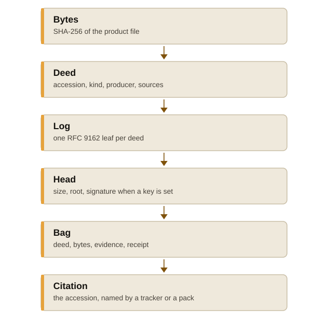

A deed is the frozen record of one product. The store holds the bytes,
the record, and an append-only log. A citation names the accession. The
bytes stay in the store.

The :doc:`tutorial <getting-started>` builds one of these by hand.
The :doc:`explanation <explanation>` says what the log adds to a
signature. The :doc:`reference <reference>` lists the files and
the verbs. The :doc:`API reference <api>` is the same model as the
``deed`` and ``deedar`` crates.

The parts
=========

   Bytes, deed, log, head, bag, citation.

The figure reads from the bytes down to the citation.

Bytes
=====

The product file is stored under its SHA-256. A deed path
``sha256:<hex>`` names that file. The hex is 64 lowercase digits, and it
is the hash of the file.

Deed
====

The accession is ``deed-<kind>-<slug>``. The record names the kind, the
producer passed as ``--agent``, the grants, the sources, and the hashes
of the bytes. The kinds are ``file``, ``set``, ``quote``, ``patch``,
``mailDraft``, ``clip``, ``page``, ``form``, ``table``, ``procedure`` and ``event``.
Each kind's flags are on the :doc:`reference <reference>` page.

A later take is a new deed that ``--supersedes`` the earlier accession.
``current`` prints the tip of that chain. The earlier accession still
resolves, and ``get`` returns the deed it names.

Log
===

Each deed appends one line. The line hashes as a Certificate
Transparency leaf, RFC 9162 (doi:10.17487/RFC9162). The head is the
tree size and the root. With a host signing key configured, the head
is signed. ``DEEDAR_HOST_SIGNING_KEY=off`` signs nothing.

An inclusion proof shows one deed in the tree a head names. A
consistency proof shows a later head extends an earlier head a reader
kept. ``export`` writes the inclusion proof into the bag. ``log bridge``
writes the consistency proof. ``check --since`` reads it. The
:doc:`explanation <explanation>` goes through both proofs, and the
diagram there is the handover between two seats.

Bag
===

``export --into DIR`` writes the deed, its bytes, its evidence, and the
receipt. Wrapped as a satchel, that directory is ``data/deeds``.
``check`` proves each receipt against the head in the bag. ``import``
holds the deeds in another store. The :doc:`how-to <howto>` signs
the bag and takes it in.

Citation
========

A tracker or a pack cites the accession, or a ``sha256:`` digest of the
deed or of a product path. ``get``, ``trail``, ``evidence`` and ``current``
answer that name. The seat passes accessions on pipes. The
:doc:`seat <seat>` page says where this crate sits among the
others.

Where next
==========

-  :doc:`Installation <install>` builds the binary.
-  :doc:`Tutorial <getting-started>` freezes one file and checks the bag.
-  :doc:`How-to guides <howto>` sign, import, audit, and serve.
-  :doc:`Explanation <explanation>` is the log and the signature.
-  :doc:`Reference <reference>` is the verbs and the on-disk files.
-  :doc:`API reference <api>` is generated from the crates.
